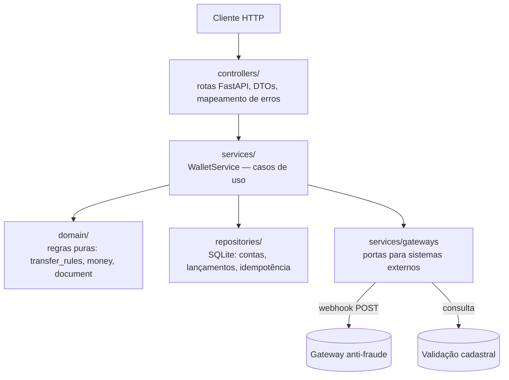
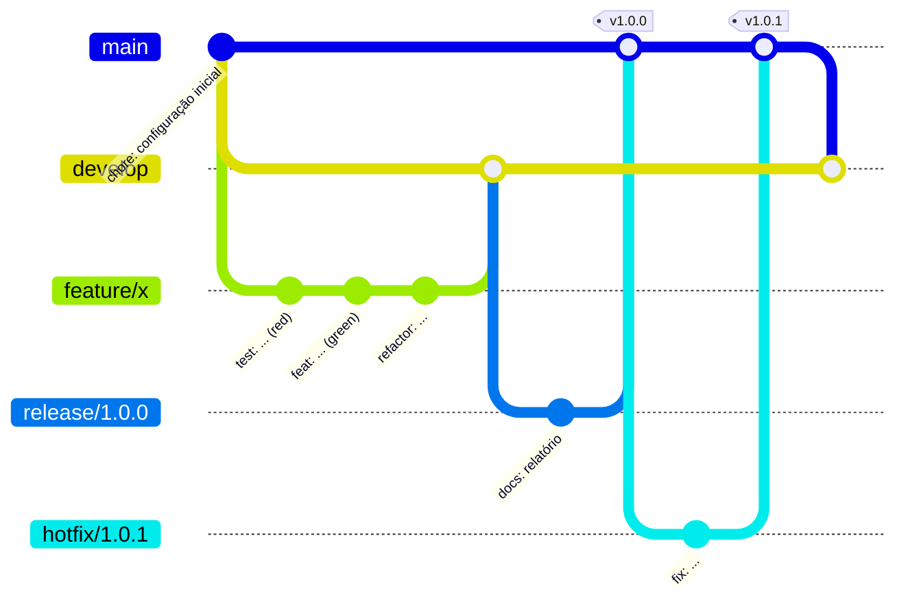

# Relatório Técnico — Wallet API

**Projeto Capstone:** API de Microsserviço Financeiro com Automação CI, Suíte de Self-Testing Multinível e Estratégia de Branching

| Item | Valor |
|---|---|
| Linguagem / framework | Python 3.14 · FastAPI |
| Persistência | SQLite (`:memory:` por padrão) |
| Testes | PyTest · Coverage.py (pytest-cov) · `unittest.mock` |
| Análise estática | Ruff (lint + formatação) |
| Carga | Locust |
| CI | GitHub Actions (`.github/workflows/ci.yml`) |
| Branching | Git Flow + Conventional Commits |

---

## 1. Visão geral

A Wallet API é um microsserviço REST simplificado de carteira digital e conciliação
bancária. Ela permite criar contas com saldo inicial, transferir valores entre contas
com garantias de atomicidade, idempotência e segurança sob concorrência, consultar o
extrato com filtros e notificar um gateway anti-fraude externo (fictício) a cada
transferência efetivada.

## 2. Especificação de Requisitos (SRS)

### 2.1 Escopo

**Dentro do escopo:** contas digitais em BRL, transferências internas, extrato,
validação cadastral do titular (CPF) e notificação anti-fraude via webhook.

**Fora do escopo:** autenticação/autorização de usuários, múltiplas moedas, estorno,
integração com o SPB/PIX e persistência distribuída.

### 2.2 Atores e sistemas externos

| Ator / sistema | Papel |
|---|---|
| Cliente da API | Sistema que cria contas, transfere e consulta extratos via HTTP |
| Serviço de validação cadastral | Informa a situação cadastral do CPF (`REGULAR`, `IRREGULAR`, `NOT_FOUND`) |
| Gateway anti-fraude | Recebe um webhook `POST` JSON a cada transferência efetivada |

### 2.3 Requisitos funcionais

| ID | Requisito | Critério de aceitação |
|---|---|---|
| **RF01** | Criar conta digital com nome do titular, CPF e saldo inicial (≥ 0). | `POST /accounts` → `201` com `id`, `balance`, `created_at`. CPF é normalizado (somente dígitos). |
| **RF02** | Validar a situação cadastral do CPF antes de abrir a conta. | CPF com situação diferente de `REGULAR` → `422 registry_rejected`; nenhuma conta é persistida. |
| **RF03** | Impedir mais de uma conta por CPF. | CPF repetido (com ou sem máscara) → `409 duplicate_document`. |
| **RF04** | Consultar conta e saldo atual. | `GET /accounts/{id}` → `200`; inexistente → `404 account_not_found`. |
| **RF05** | Transferir saldo entre duas contas. | `POST /transfers` → `201`; débito na origem e crédito no destino na mesma transação. |
| **RF06** | Rejeitar transferência com saldo insuficiente. | `422 insufficient_funds`; nenhum saldo ou lançamento é alterado. |
| **RF07** | Garantir idempotência de transferências via header `Idempotency-Key`. | Repetição com mesma chave e mesmo payload → `200` + header `Idempotent-Replayed: true` e mesmo corpo, **sem novo débito**. Mesma chave com payload diferente → `409 idempotency_conflict`. |
| **RF08** | Tratar transferências concorrentes sem saldo negativo e sem perda/criação de dinheiro. | 50 transferências simultâneas: o saldo final é consistente e nunca negativo. |
| **RF09** | Consultar extrato da conta com filtros por período (`start_date`, `end_date`, inclusivos) e por tipo (`debit`/`credit`). | `GET /accounts/{id}/statement` → lançamentos em ordem cronológica, totais de crédito e débito; período invertido → `422 invalid_period`. |
| **RF10** | Notificar o gateway anti-fraude a cada transferência efetivada. | Exatamente **uma** chamada por transferência, com `transfer_id`, contas, valor, moeda e data. Nenhuma chamada em falhas ou em replays idempotentes. |

### 2.4 Regras de negócio

| ID | Regra |
|---|---|
| **RN01** | Valores monetários são positivos e têm no máximo 2 casas decimais; internamente são armazenados em **centavos inteiros**. |
| **RN02** | Origem e destino de uma transferência devem ser contas diferentes. |
| **RN03** | Cada transferência tem um limite máximo configurável (`MAX_TRANSFER_AMOUNT`, padrão R$ 100.000,00). |
| **RN04** | Toda transferência gera dois lançamentos: `debit` na origem e `credit` no destino, ligados pelo `transfer_id`. |
| **RN05** | O saldo inicial maior que zero gera um lançamento de crédito “Saldo inicial”. |
| **RN06** | Falha no gateway anti-fraude **não** desfaz uma transferência já efetivada; a falha é registrada em log. |

### 2.5 Requisitos não funcionais

| ID | Categoria | Requisito | Como é verificado |
|---|---|---|---|
| **RNF01** | Confiabilidade | Operações de transferência são atômicas (tudo ou nada). | Transação `BEGIN IMMEDIATE`/`ROLLBACK`; teste `test_transacao_faz_rollback_em_caso_de_erro`. |
| **RNF02** | Consistência | Saldo nunca negativo, garantido também no banco. | `CHECK (balance_cents >= 0)`; teste de constraint e de concorrência. |
| **RNF03** | Concorrência | Sem deadlock nem travamento com ≥ 50 requisições simultâneas. | `tests/integration/test_concurrency.py` + teste de carga com Locust. |
| **RNF04** | Desempenho | Latência média < 100 ms e taxa de erro < 1% em `/transfers` com 50 usuários simultâneos. | Job `load-test` do CI (`scripts/load_report.py` falha se erro > 1%). |
| **RNF05** | Testabilidade | Cobertura mínima de **85% de linhas** e **80% de branches**. | Coverage gate (`scripts/check_coverage.py`) no CI. |
| **RNF06** | Manutenibilidade | Código sem violações de lint e formatado de forma padronizada. | Job `lint` (Ruff) no CI. |
| **RNF07** | Precisão | Nenhum erro de arredondamento em valores monetários. | Uso de `Decimal` + centavos inteiros; `test_nao_sofre_erro_de_ponto_flutuante`. |
| **RNF08** | Resiliência | Indisponibilidade do gateway anti-fraude não afeta a transferência. | Timeout configurável + teste com Mock que lança exceção (`side_effect`). |
| **RNF09** | Portabilidade | Configuração por variáveis de ambiente. | `.env.example`, `src/config.py`. |

## 3. Arquitetura

### 3.1 Camadas



| Pasta | Responsabilidade | Depende de |
|---|---|---|
| `src/domain` | Entidades, exceções e **regras puras** (sem I/O). Alvo do TDD. | — |
| `src/repositories` | Acesso ao SQLite, schema e controle transacional. | `domain` |
| `src/services` | Orquestra casos de uso; define as portas `AntiFraudGateway` e `RegistryService`. | `domain`, `repositories` |
| `src/controllers` | Rotas REST, validação de entrada (Pydantic) e tradução de exceções em HTTP. | `services` |
| `src/main.py` | Composição (injeção de dependências) e criação da app. | todos |

### 3.2 Decisões de projeto

1. **Centavos inteiros + `Decimal`.** Evita erros de ponto flutuante (`0.1 + 0.2`).
2. **Regras puras isoladas** (`plan_transfer`) recebem saldos e devolvem um `TransferPlan`
   — testáveis sem banco, sem HTTP e sem relógio.
3. **Portas e adaptadores para serviços externos.** O serviço depende de *protocolos*;
   a implementação real (`HttpAntiFraudGateway`, `LocalRegistryService`) é injetada em
   `main.py`, e os testes injetam Mocks e Stubs.
4. **Relógio injetável** (`clock`), permitindo testes determinísticos de filtros por data.
5. **Concorrência.** Endpoints síncronos rodam no pool de threads do FastAPI. Toda
   operação no SQLite é serializada por um `RLock` e executada em `BEGIN IMMEDIATE`.
   Leitura de saldo, validação e escrita ocorrem **na mesma transação**, eliminando a
   condição de corrida *read-modify-write*. O `CHECK` no banco é a última linha de defesa.
6. **Idempotência.** A chave é gravada na **mesma transação** da transferência, junto
   com o hash SHA-256 de `(origem, destino, valor)`. Transferências que falham não
   consomem a chave, permitindo nova tentativa.
7. **Notificação anti-fraude após o commit**, fora da transação, para que a latência
   ou falha do gateway não segure o lock do banco nem desfaça a transferência.

### 3.3 Modelo de dados

| Tabela | Campos principais |
|---|---|
| `accounts` | `id`, `owner_name`, `document` (UNIQUE), `balance_cents` (CHECK ≥ 0), `created_at` |
| `transfers` | `id`, `source_account_id`, `destination_account_id`, `amount_cents` (CHECK > 0), `description`, `created_at` |
| `transactions` | `id`, `account_id`, `type` (`debit`/`credit`), `amount_cents`, `transfer_id`, `counterparty_account_id`, `created_at` — índice `(account_id, created_at)` |
| `idempotency_keys` | `key` (PK), `request_hash`, `transfer_id`, `created_at` |

## 4. Contrato da API

| Método | Rota | Sucesso | Erros |
|---|---|---|---|
| `POST` | `/accounts` | `201` | `409 duplicate_document`, `422 registry_rejected`, `422 invalid_amount`, `422` validação |
| `GET` | `/accounts/{id}` | `200` | `404 account_not_found` |
| `GET` | `/accounts/{id}/statement` | `200` | `404`, `422 invalid_period`, `422` tipo inválido |
| `POST` | `/transfers` | `201` (nova) / `200` (replay) | `404`, `409 idempotency_conflict`, `422 insufficient_funds`, `422 same_account_transfer`, `422 transfer_limit_exceeded`, `422 invalid_amount` |
| `GET` | `/health` | `200` | — |

Erros de domínio seguem sempre o formato `{"code": "...", "message": "..."}`.
Payload enviado ao webhook anti-fraude:

```json
{
  "event": "transfer.completed",
  "transfer_id": "uuid",
  "source_account_id": "uuid",
  "destination_account_id": "uuid",
  "amount": "123.45",
  "currency": "BRL",
  "occurred_at": "2026-01-10T12:00:00+00:00"
}
```

## 5. Estratégia de branching e controle de versão

### 5.1 Modelo adotado: Git Flow



| Branch | Origem | Destino | Uso |
|---|---|---|---|
| `main` | — | — | Código em produção. Cada merge recebe uma tag `vX.Y.Z`. |
| `develop` | `main` | — | Integração contínua das features. |
| `feature/<nome>` | `develop` | `develop` | Uma funcionalidade por branch, curta. |
| `release/<versão>` | `develop` | `main` e `develop` | Estabilização e documentação da versão. |
| `hotfix/<versão>-<nome>` | `main` | `main` e `develop` | Correção emergencial em produção. |

### 5.2 Regras de proteção

- `main` e `develop` são **protegidas**: não aceitam push direto; toda mudança entra por
  *pull request* com merge commit (`--no-ff`), preservando o histórico das branches.
- O merge só é liberado quando os *status checks* obrigatórios do CI passam:
  `Lint & análise estática`, `Testes & coverage gate` e `Teste de carga (50 usuários)`.
  Assim, **um teste quebrado ou cobertura abaixo do mínimo bloqueia o merge**.

### 5.3 Convenção de commits

[Conventional Commits](https://www.conventionalcommits.org/pt-br/): `tipo(escopo): descrição`.

| Tipo | Uso |
|---|---|
| `feat` | Nova funcionalidade (fase *Green* do TDD) |
| `test` | Novos testes (fase *Red* do TDD) |
| `refactor` | Melhoria interna sem mudança de comportamento (fase *Refactor*) |
| `fix` | Correção de defeito (hotfixes) |
| `ci` | Pipeline |
| `docs` | Documentação |
| `chore` | Configuração e manutenção |
