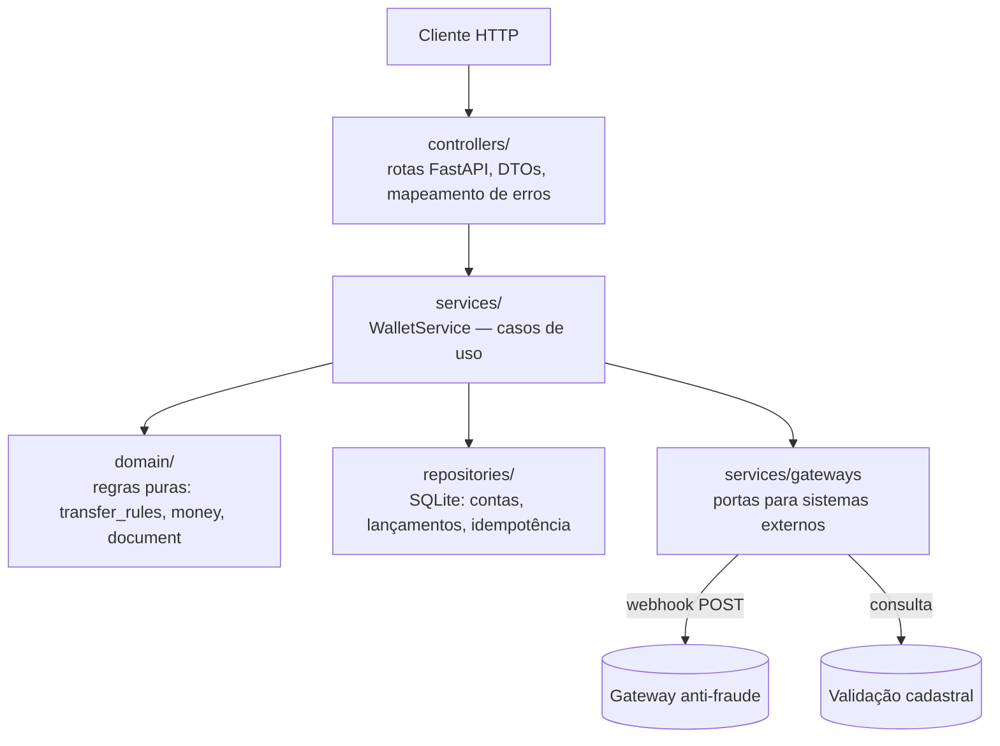
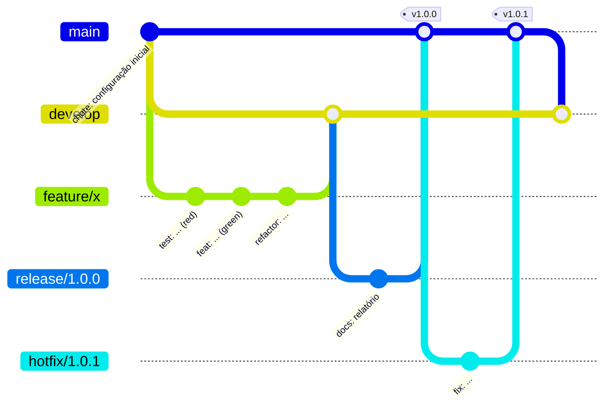
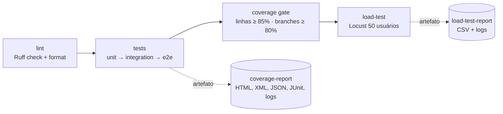

# Relatório Técnico — Wallet API

**Projeto Capstone:** API de Microsserviço Financeiro com Automação CI, Suíte de Self-Testing Multinível e Estratégia de Branching

| Item | Valor |
|---|---|
| Linguagem / framework | Python 3.14 · FastAPI |
| Persistência | SQLite (`:memory:` por padrão) |
| Testes | PyTest · Coverage.py (pytest-cov) · `unittest.mock` |
| Análise estática | Ruff (lint + formatação) |
| Carga | Locust |
| CI | GitHub Actions (`.github/workflows/ci.yml`) |
| Branching | Git Flow + Conventional Commits |

---

## 1. Visão geral

A Wallet API é um microsserviço REST simplificado de carteira digital e conciliação
bancária. Ela permite criar contas com saldo inicial, transferir valores entre contas
com garantias de atomicidade, idempotência e segurança sob concorrência, consultar o
extrato com filtros e notificar um gateway anti-fraude externo (fictício) a cada
transferência efetivada.

## 2. Especificação de Requisitos (SRS)

### 2.1 Escopo

**Dentro do escopo:** contas digitais em BRL, transferências internas, extrato,
validação cadastral do titular (CPF) e notificação anti-fraude via webhook.

**Fora do escopo:** autenticação/autorização de usuários, múltiplas moedas, estorno,
integração com o SPB/PIX e persistência distribuída.

### 2.2 Atores e sistemas externos

| Ator / sistema | Papel |
|---|---|
| Cliente da API | Sistema que cria contas, transfere e consulta extratos via HTTP |
| Serviço de validação cadastral | Informa a situação cadastral do CPF (`REGULAR`, `IRREGULAR`, `NOT_FOUND`) |
| Gateway anti-fraude | Recebe um webhook `POST` JSON a cada transferência efetivada |

### 2.3 Requisitos funcionais

| ID | Requisito | Critério de aceitação |
|---|---|---|
| **RF01** | Criar conta digital com nome do titular, CPF e saldo inicial (≥ 0). | `POST /accounts` → `201` com `id`, `balance`, `created_at`. CPF é normalizado (somente dígitos). |
| **RF02** | Validar a situação cadastral do CPF antes de abrir a conta. | CPF com situação diferente de `REGULAR` → `422 registry_rejected`; nenhuma conta é persistida. |
| **RF03** | Impedir mais de uma conta por CPF. | CPF repetido (com ou sem máscara) → `409 duplicate_document`. |
| **RF04** | Consultar conta e saldo atual. | `GET /accounts/{id}` → `200`; inexistente → `404 account_not_found`. |
| **RF05** | Transferir saldo entre duas contas. | `POST /transfers` → `201`; débito na origem e crédito no destino na mesma transação. |
| **RF06** | Rejeitar transferência com saldo insuficiente. | `422 insufficient_funds`; nenhum saldo ou lançamento é alterado. |
| **RF07** | Garantir idempotência de transferências via header `Idempotency-Key`. | Repetição com mesma chave e mesmo payload → `200` + header `Idempotent-Replayed: true` e mesmo corpo, **sem novo débito**. Mesma chave com payload diferente → `409 idempotency_conflict`. |
| **RF08** | Tratar transferências concorrentes sem saldo negativo e sem perda/criação de dinheiro. | 50 transferências simultâneas: o saldo final é consistente e nunca negativo. |
| **RF09** | Consultar extrato da conta com filtros por período (`start_date`, `end_date`, inclusivos) e por tipo (`debit`/`credit`). | `GET /accounts/{id}/statement` → lançamentos em ordem cronológica, totais de crédito e débito; período invertido → `422 invalid_period`. |
| **RF10** | Notificar o gateway anti-fraude a cada transferência efetivada. | Exatamente **uma** chamada por transferência, com `transfer_id`, contas, valor, moeda e data. Nenhuma chamada em falhas ou em replays idempotentes. |

### 2.4 Regras de negócio

| ID | Regra |
|---|---|
| **RN01** | Valores monetários são positivos e têm no máximo 2 casas decimais; internamente são armazenados em **centavos inteiros**. |
| **RN02** | Origem e destino de uma transferência devem ser contas diferentes. |
| **RN03** | Cada transferência tem um limite máximo configurável (`MAX_TRANSFER_AMOUNT`, padrão R$ 100.000,00). |
| **RN04** | Toda transferência gera dois lançamentos: `debit` na origem e `credit` no destino, ligados pelo `transfer_id`. |
| **RN05** | O saldo inicial maior que zero gera um lançamento de crédito “Saldo inicial”. |
| **RN06** | Falha no gateway anti-fraude **não** desfaz uma transferência já efetivada; a falha é registrada em log. |

### 2.5 Requisitos não funcionais

| ID | Categoria | Requisito | Como é verificado |
|---|---|---|---|
| **RNF01** | Confiabilidade | Operações de transferência são atômicas (tudo ou nada). | Transação `BEGIN IMMEDIATE`/`ROLLBACK`; teste `test_transacao_faz_rollback_em_caso_de_erro`. |
| **RNF02** | Consistência | Saldo nunca negativo, garantido também no banco. | `CHECK (balance_cents >= 0)`; teste de constraint e de concorrência. |
| **RNF03** | Concorrência | Sem deadlock nem travamento com ≥ 50 requisições simultâneas. | `tests/integration/test_concurrency.py` + teste de carga com Locust. |
| **RNF04** | Desempenho | Latência média < 100 ms e taxa de erro < 1% em `/transfers` com 50 usuários simultâneos. | Job `load-test` do CI (`scripts/load_report.py` falha se erro > 1%). |
| **RNF05** | Testabilidade | Cobertura mínima de **85% de linhas** e **80% de branches**. | Coverage gate (`scripts/check_coverage.py`) no CI. |
| **RNF06** | Manutenibilidade | Código sem violações de lint e formatado de forma padronizada. | Job `lint` (Ruff) no CI. |
| **RNF07** | Precisão | Nenhum erro de arredondamento em valores monetários. | Uso de `Decimal` + centavos inteiros; `test_nao_sofre_erro_de_ponto_flutuante`. |
| **RNF08** | Resiliência | Indisponibilidade do gateway anti-fraude não afeta a transferência. | Timeout configurável + teste com Mock que lança exceção (`side_effect`). |
| **RNF09** | Portabilidade | Configuração por variáveis de ambiente. | `.env.example`, `src/config.py`. |

## 3. Arquitetura

### 3.1 Camadas



| Pasta | Responsabilidade | Depende de |
|---|---|---|
| `src/domain` | Entidades, exceções e **regras puras** (sem I/O). Alvo do TDD. | — |
| `src/repositories` | Acesso ao SQLite, schema e controle transacional. | `domain` |
| `src/services` | Orquestra casos de uso; define as portas `AntiFraudGateway` e `RegistryService`. | `domain`, `repositories` |
| `src/controllers` | Rotas REST, validação de entrada (Pydantic) e tradução de exceções em HTTP. | `services` |
| `src/main.py` | Composição (injeção de dependências) e criação da app. | todos |

### 3.2 Decisões de projeto

1. **Centavos inteiros + `Decimal`.** Evita erros de ponto flutuante (`0.1 + 0.2`).
2. **Regras puras isoladas** (`plan_transfer`) recebem saldos e devolvem um `TransferPlan`
   — testáveis sem banco, sem HTTP e sem relógio.
3. **Portas e adaptadores para serviços externos.** O serviço depende de *protocolos*;
   a implementação real (`HttpAntiFraudGateway`, `LocalRegistryService`) é injetada em
   `main.py`, e os testes injetam Mocks e Stubs.
4. **Relógio injetável** (`clock`), permitindo testes determinísticos de filtros por data.
5. **Concorrência.** Endpoints síncronos rodam no pool de threads do FastAPI. Toda
   operação no SQLite é serializada por um `RLock` e executada em `BEGIN IMMEDIATE`.
   Leitura de saldo, validação e escrita ocorrem **na mesma transação**, eliminando a
   condição de corrida *read-modify-write*. O `CHECK` no banco é a última linha de defesa.
6. **Idempotência.** A chave é gravada na **mesma transação** da transferência, junto
   com o hash SHA-256 de `(origem, destino, valor)`. Transferências que falham não
   consomem a chave, permitindo nova tentativa.
7. **Notificação anti-fraude após o commit**, fora da transação, para que a latência
   ou falha do gateway não segure o lock do banco nem desfaça a transferência.

### 3.3 Modelo de dados

| Tabela | Campos principais |
|---|---|
| `accounts` | `id`, `owner_name`, `document` (UNIQUE), `balance_cents` (CHECK ≥ 0), `created_at` |
| `transfers` | `id`, `source_account_id`, `destination_account_id`, `amount_cents` (CHECK > 0), `description`, `created_at` |
| `transactions` | `id`, `account_id`, `type` (`debit`/`credit`), `amount_cents`, `transfer_id`, `counterparty_account_id`, `created_at` — índice `(account_id, created_at)` |
| `idempotency_keys` | `key` (PK), `request_hash`, `transfer_id`, `created_at` |

## 4. Contrato da API

| Método | Rota | Sucesso | Erros |
|---|---|---|---|
| `POST` | `/accounts` | `201` | `409 duplicate_document`, `422 registry_rejected`, `422 invalid_amount`, `422` validação |
| `GET` | `/accounts/{id}` | `200` | `404 account_not_found` |
| `GET` | `/accounts/{id}/statement` | `200` | `404`, `422 invalid_period`, `422` tipo inválido |
| `POST` | `/transfers` | `201` (nova) / `200` (replay) | `404`, `409 idempotency_conflict`, `422 insufficient_funds`, `422 same_account_transfer`, `422 transfer_limit_exceeded`, `422 invalid_amount` |
| `GET` | `/health` | `200` | — |

Erros de domínio seguem sempre o formato `{"code": "...", "message": "..."}`.
Payload enviado ao webhook anti-fraude:

```json
{
  "event": "transfer.completed",
  "transfer_id": "uuid",
  "source_account_id": "uuid",
  "destination_account_id": "uuid",
  "amount": "123.45",
  "currency": "BRL",
  "occurred_at": "2026-01-10T12:00:00+00:00"
}
```

## 5. Estratégia de branching e controle de versão

### 5.1 Modelo adotado: Git Flow



| Branch | Origem | Destino | Uso |
|---|---|---|---|
| `main` | — | — | Código em produção. Cada merge recebe uma tag `vX.Y.Z`. |
| `develop` | `main` | — | Integração contínua das features. |
| `feature/<nome>` | `develop` | `develop` | Uma funcionalidade por branch, curta. |
| `release/<versão>` | `develop` | `main` e `develop` | Estabilização e documentação da versão. |
| `hotfix/<versão>-<nome>` | `main` | `main` e `develop` | Correção emergencial em produção. |

### 5.2 Regras de proteção

- `main` e `develop` são **protegidas**: não aceitam push direto; toda mudança entra por
  *pull request* com merge commit (`--no-ff`), preservando o histórico das branches.
- O merge só é liberado quando os *status checks* obrigatórios do CI passam:
  `Lint & análise estática`, `Testes & coverage gate` e `Teste de carga (50 usuários)`.
  Assim, **um teste quebrado ou cobertura abaixo do mínimo bloqueia o merge**.

### 5.3 Convenção de commits

[Conventional Commits](https://www.conventionalcommits.org/pt-br/): `tipo(escopo): descrição`.

| Tipo | Uso |
|---|---|
| `feat` | Nova funcionalidade (fase *Green* do TDD) |
| `test` | Novos testes (fase *Red* do TDD) |
| `refactor` | Melhoria interna sem mudança de comportamento (fase *Refactor*) |
| `fix` | Correção de defeito (hotfixes) |
| `ci` | Pipeline |
| `docs` | Documentação |
| `chore` | Configuração e manutenção |

## 6. Estratégia de testes

### 6.1 Pirâmide de testes

| Camada | Pasta | Testes | O que valida | Dependências reais |
|---|---|---:|---|---|
| Unitários | `tests/unit` | 52 | Regras puras de transferência, dinheiro, CPF, configuração e o próprio coverage gate | Nenhuma |
| Integração | `tests/integration` | 46 | Casos de uso com SQLite em memória, Mocks e Stubs; concorrência; adaptadores | SQLite `:memory:` |
| E2E | `tests/e2e` | 22 | Fluxo completo via HTTP: registro → transferência → extrato; contrato de erros | App completa (TestClient e Uvicorn em socket real) |

A base é mais larga (testes rápidos e isolados) e o topo mais estreito (testes mais
caros, focados em fluxos de negócio). A suíte completa executa em ~2 segundos.

### 6.2 TDD — ciclo Red → Green → Refactor

As regras financeiras foram desenvolvidas com TDD, e o ciclo fica registrado no
histórico do Git (`git log --oneline -- src/domain tests/unit`):

| Fase | Commit | Estado da suíte |
|---|---|---|
| 🔴 Red | `test(domain): especifica regras de transferência (red)` | Testes falham (`NotImplementedError`) |
| 🟢 Green | `feat(domain): implementa cálculo de transferência (green)` | Testes passam com a implementação mais simples |
| 🔵 Refactor | `refactor(domain): extrai validações em funções guardiãs` | Testes continuam passando; código mais legível |
| 🔴 Red | `test(domain): especifica conversão monetária e validação de CPF (red)` | Testes falham |
| 🟢 Green | `feat(domain): implementa conversão monetária e validação de CPF (green)` | Testes passam |
| 🔴 Red | `test(services): especifica casos de uso com mocks, stubs e SQLite (red)` | Testes falham (serviço inexistente) |
| 🟢 Green | `feat(services): implementa casos de uso da carteira (green)` | Testes passam |

Qualidade das asserções: os testes verificam **valores exatos** (saldos em centavos,
corpo JSON completo, ordem dos lançamentos), **efeitos colaterais ausentes** (saldo
inalterado após falha, nenhuma notificação em erro) e **invariantes** (conservação do
total de dinheiro entre contas, saldo nunca negativo).

### 6.3 Test doubles

| Double | Onde | Papel | Exemplo de verificação |
|---|---|---|---|
| **Mock** | `make_antifraud_mock()` — `create_autospec(HttpAntiFraudGateway, spec_set=True)` | Verificar **interações de saída** com o gateway anti-fraude | `assert_called_once_with({...payload exato...})`, `call_count == 3`, `assert_not_called()` em falhas e replays |
| **Stub** | `StubRegistryService` | Prover **dados de entrada fixos** de validação cadastral | Retorna `IRREGULAR`/`NOT_FOUND` para um CPF e `REGULAR` para outro; o teste verifica o *comportamento do serviço*, nunca o stub |
| **Fake** | `FakeClock` | Relógio controlável para filtros de data | `clock.set(datetime(2026, 1, 11, 9, 0))` |
| **BD em memória** | `Database(":memory:")` | Persistência real e isolada por teste | Saldos, constraints e rollback verificados no banco |

A distinção é deliberada: o **Mock** é usado onde o resultado observável é a *chamada*
para fora (o gateway não retorna nada útil), e o **Stub** onde o colaborador apenas
*alimenta* o sistema com dados. O `autospec` faz o teste falhar se a assinatura do
gateway real mudar.

## 7. Pipeline de Integração Contínua

Arquivo: `.github/workflows/ci.yml`.

| Gatilho | Branches |
|---|---|
| `push` | `main`, `develop`, `feature/**`, `release/**`, `hotfix/**` |
| `pull_request` | para `main` e `develop` |



- **Lint/análise estática:** `ruff check` (regras E, F, W, I, B, UP, SIM, C4, PT, RUF) e
  `ruff format --check`.
- **Testes:** cada camada roda em um passo separado (falha localizada), acumulando a
  cobertura com `--cov-append`. Logs de cada passo são gravados em `reports/logs/`.
- **Coverage gate:** `scripts/check_coverage.py` lê o `coverage.json` e verifica **linhas
  e branches separadamente** (o `--cov-fail-under` nativo só checa um total combinado).
  Se qualquer métrica ficar abaixo do mínimo, o job falha com exit code 1.
- **Artefatos:** relatório de cobertura (HTML/XML/JSON), resultados JUnit, logs e CSVs do
  teste de carga são publicados com `actions/upload-artifact` (retenção de 14 dias),
  inclusive quando o job falha (`if: always()`).
- **Bloqueio de merge:** com as regras de proteção da seção 5.2, um PR com qualquer job
  vermelho não pode ser mesclado.

## 8. Cobertura de código

Resultado da suíte completa (120 testes):

| Métrica | Resultado | Mínimo exigido |
|---|---:|---:|
| Linhas / statements | **99,77%** (435/436) | 85% |
| Branches | **96,15%** (50/52) | 80% |

## 9. Desempenho e resiliência

### 9.1 Configuração do teste de carga

- **Ferramenta:** Locust (`tests/load/locustfile.py`).
- **Concorrência:** **50 usuários virtuais simultâneos** (`-u 50 -r 50`), espera de
  50–200 ms entre requisições.
- **Cenário:** cada usuário cria duas contas próprias e dispara transferências com
  `Idempotency-Key` única. 25% das requisições usam um **par de contas compartilhado
  por todos os usuários**, forçando disputa pelo mesmo saldo.
- **Critério de aprovação:** taxa de erro em `/transfers` ≤ 1%
  (`scripts/load_report.py`, que faz o job falhar caso contrário).

### 9.2 Resultados (execução local, 60 s, Uvicorn com 1 worker)

| Endpoint | Requisições | Falhas | Taxa de erro | Latência média | Mediana | p95 | p99 | Máx. | RPS |
|---|---:|---:|---:|---:|---:|---:|---:|---:|---:|
| `/transfers` (contas próprias) | 16.482 | 0 | **0,00%** | **6,8 ms** | 6 ms | 14 ms | 19 ms | 52 ms | 278,5 |
| `/transfers` (contas compartilhadas) | 5.497 | 0 | **0,00%** | **6,8 ms** | 6 ms | 14 ms | 18 ms | 51 ms | 92,9 |
| `/accounts` (preparação) | 102 | 0 | 0,00% | 57,9 ms | 47 ms | 130 ms | 140 ms | 142 ms | 1,7 |
| **Total** | **22.081** | **0** | **0,00%** | **7,1 ms** | 6 ms | 14 ms | 20 ms | 142 ms | **373,0** |

### 9.3 Análise

- **Sem travamento sob concorrência:** 21.979 transferências em 60 s com 50 usuários,
  nenhuma falha, nenhum timeout e latência máxima de 52 ms em `/transfers`.
- A serialização por lock é o gargalo teórico, mas como cada transação é curta (poucas
  instruções em memória) o throughput (~370 req/s) é amplamente suficiente para o escopo.
- A integridade sob concorrência é comprovada de forma determinística pelos testes de
  integração (`test_concurrency.py`): 50 threads disputando um saldo de R$ 50,00 com
  débitos de R$ 2,00 resultam em **exatamente 25 sucessos e 25 recusas**; transferências
  cruzadas conservam o total; 50 requisições paralelas com a mesma `Idempotency-Key`
  geram **uma única** transferência e **uma única** notificação anti-fraude.
- No CI o teste roda por 30 s para manter o pipeline rápido; os CSVs ficam no artefato
  `load-test-report` e a tabela-resumo aparece no *job summary* do GitHub Actions.

## 10. Como reproduzir

```bash
pip install -r requirements-dev.txt
make lint                 # análise estática
make coverage-gate        # testes + relatórios em reports/ + gate
uvicorn src.main:app      # em outro terminal
make load                 # teste de carga (50 usuários, 60 s)
```

## 11. Histórico de correções emergenciais (hotfixes)

Ambas seguiram o fluxo Git Flow: branch `hotfix/*` criada a partir de `main`, PR
validado pelo CI, merge em `main` com nova tag e merge de volta em `develop`.

### Hotfix 1.0.1 — falha no gateway anti-fraude quebrava a transferência

- **Branch:** `hotfix/1.0.1-antifraude-resiliencia` → tag `v1.0.1`
- **Sintoma:** quando o webhook anti-fraude ficava indisponível (timeout/5xx), a
  exceção subia até a API, que respondia `500` — **mas o dinheiro já tinha sido
  movimentado**, pois a notificação ocorre após o commit. O cliente, vendo erro,
  repetia a requisição e (sem `Idempotency-Key`) gerava transferência duplicada.
- **Correção:** a notificação passou a ser *best-effort*: exceções do gateway são
  capturadas e registradas em log (RN06/RNF08).
- **Teste de regressão:** `tests/integration/test_antifraud_resilience.py` — o Mock é
  configurado com `side_effect = httpx.ConnectTimeout(...)` e o teste verifica que a
  transferência é efetivada, que o gateway foi chamado uma vez e que o erro foi logado.

### Hotfix 1.0.2 — extrato ignorava lançamentos do dia `end_date`

- **Branch:** `hotfix/1.0.2-extrato-end-date` → tag `v1.0.2`
- **Sintoma:** o filtro `end_date=2026-03-20` era convertido em `< 2026-03-20T00:00`,
  excluindo todos os lançamentos do próprio dia 20 (o requisito RF09 define o período
  como inclusivo).
- **Correção:** o limite superior passou a ser exclusivo no **dia seguinte**
  (`< end_date + 1 dia`), formando um intervalo semiaberto `[start, end + 1)`.
- **Testes de regressão:** `tests/integration/test_statement_end_date_regression.py` —
  lançamento às 23:59:59 do dia `end_date` é incluído; lançamento à 00:00 do dia
  seguinte é excluído.
